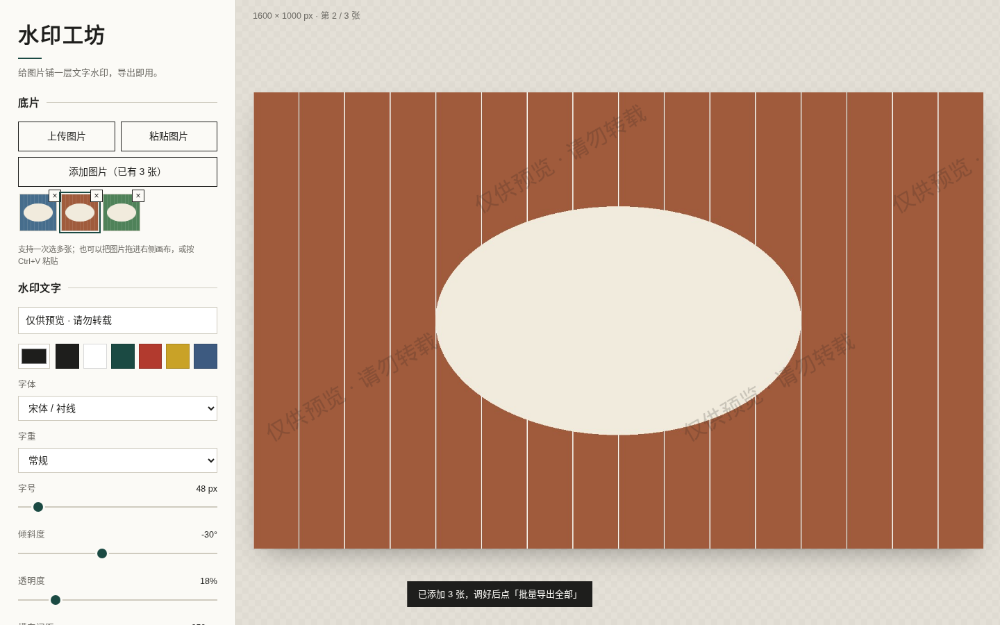

# Watermark Maker

[中文](README.md) | English

Paste or upload an image, style a text watermark — text, slant, opacity, size, color — and export. It's a single HTML file that runs entirely in the browser. Your images never leave your computer.

[**Try it online →**](https://ykykle.github.io/watermark-maker/)

## Features

- **Add images**: upload, paste with Ctrl+V (⌘V on Mac), drag and drop onto the canvas, or select several at once
- **Watermark style**: text, font family, weight, size, color (6 presets), slant (-180° to 180°), opacity, horizontal and vertical spacing
- **Layout**: tile across the image or place a single centered line; optional staggered rows and alternating slant; drag to reposition the single line
- **Batch**: apply one set of settings to many images and export them all at once
- **Export**: PNG (lossless, keeps transparency) or JPEG (adjustable quality)
- **Remembers your settings**: parameters are stored in your browser (localStorage) and restored on the next visit. Nothing is sent to a server

## Usage

### Online

Open the [live demo](https://ykykle.github.io/watermark-maker/). Nothing to install.

### Locally

Download [watermark-maker.html](watermark-maker.html) and open it in your browser. No internet connection or installation needed.

## Browser support

A modern browser with Canvas and `toBlob`: Chrome / Edge 90+, Firefox 90+, Safari 15+.

Fonts come from the operating system, so glyphs differ slightly between platforms. If you need identical output everywhere, export before moving the file.

## Privacy

All image processing happens in the browser. Nothing is uploaded and no external resources are requested. Settings stay in your own browser.

## Development

There is no build step. Edit `watermark-maker.html` and refresh. Once GitHub Pages is enabled, pushing to `main` publishes automatically.

## License

[MIT](LICENSE) © 2026 ykykle
