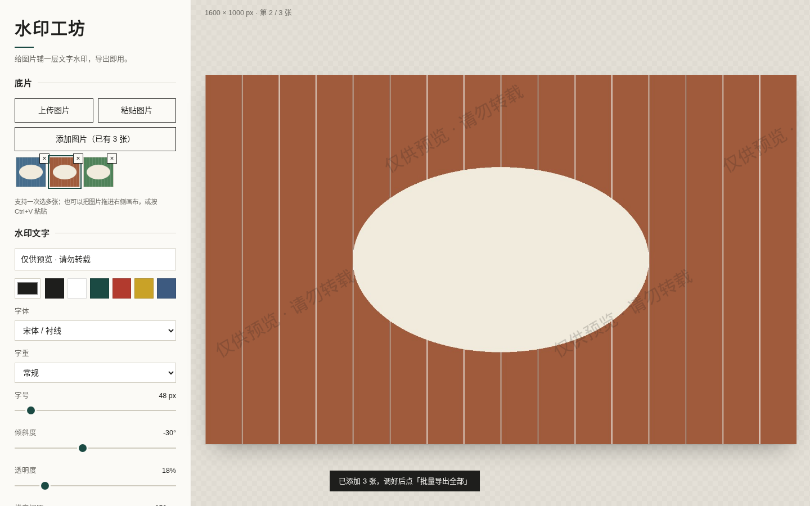

# 水印工坊 · Watermark Maker

中文 | [English](README.en.md)

给图片铺一层文字水印：粘贴或上传底片，调整文字、倾斜度、透明度、字号和颜色，导出即用。单个 HTML 文件，纯浏览器运行，图片不会离开你的电脑。

[**在线使用 →**](https://ykykle.github.io/watermark-maker/)

## 功能

- **添加底片**：点击上传、粘贴按钮配合 Ctrl+V（Mac 为 ⌘V）、直接拖进画布，或一次选择多张图片
- **水印样式**：文字内容、字体、字重、字号、颜色（含 6 个预设色）、倾斜度（-180° 到 180°）、透明度、横纵间距
- **排布方式**：平铺满图或居中单条；可开启隔行错位、隔行反向倾斜；单条模式下在画布上拖动定位
- **批量处理**：多张图片共用同一套水印参数，一键全部导出
- **导出格式**：PNG（无损、保留透明）或 JPEG（可调质量）
- **记住设置**：水印参数保存在浏览器本地（localStorage），下次打开自动恢复；不涉及任何服务器

## 使用

### 在线使用

打开 [线上地址](https://ykykle.github.io/watermark-maker/)，无需安装。

### 本地使用

下载 [watermark-maker.html](watermark-maker.html)，双击用浏览器打开即可，不需要联网或安装任何东西。

## 浏览器支持

需要支持 Canvas 与 `toBlob` 的现代浏览器：Chrome / Edge 90+、Firefox 90+、Safari 15+。

字体使用系统自带字体，不同系统上字形会略有差异；想得到完全一致的效果，建议导出后在目标平台上使用。

## 隐私

所有图片处理都在浏览器内完成，不上传、不请求任何外部资源。设置仅保存在你自己的浏览器里。

## 本地开发

没有构建步骤。改完 `watermark-maker.html` 刷新浏览器即可。上线到 GitHub Pages 后，推送 `main` 分支会自动发布。

## 开源协议

[MIT](LICENSE) © 2026 ykykle
